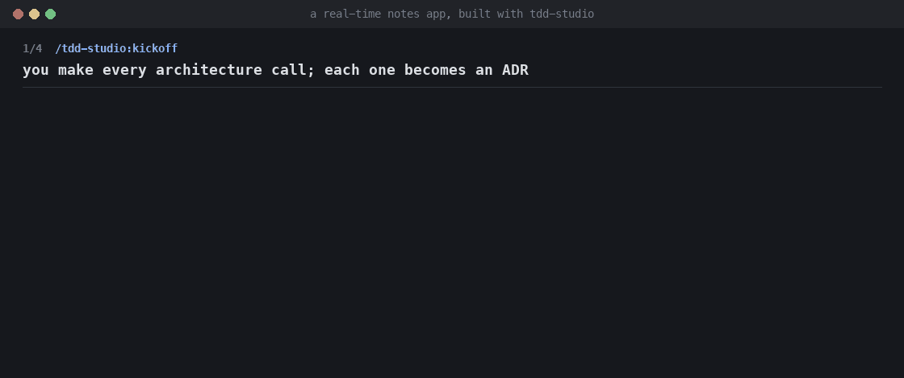

# tdd-studio

**Let Claude Code build your project while you stay the architect, and know it works
because a test proved it.**



<sub>Replayed from the repository of a real project built with tdd-studio. Every line is
real output from that project's git history and docs.</sub>

## Why

Coding agents are fast, but on a real project they let you down in three ways:

1. **They decide for you.** You only find out the storage layer changed when it breaks.
2. **They say "done" when it isn't.** The tests pass, but nothing checks the behaviour
   that matters.
3. **They forget.** When the session ends, the plan, the decisions and what was half
   finished all go with it.

tdd-studio is a Claude Code plugin that deals with all three:

- **You make every significant call.** Each decision is laid out with its options and a
  recommendation, then recorded as an ADR that stays *Proposed* until you accept it.
- **"Done" means a test proved it.** Every milestone starts with a test that is expected
  to fail. Every task goes red, then green, then gets a **sabotage check**: break the
  behaviour on purpose and watch the test catch it. Then the tests run repeatedly to
  rule out flakes.
- **The repo is the memory.** Progress, decisions and the next action are committed with
  the code, one commit per task. A new session reads the repo, checks it against git,
  and carries on.

## Commands

| Command | What it does |
|---|---|
| `/tdd-studio:kickoff` | Takes an idea to an agreed architecture, one decision at a time, each recorded as an ADR |
| `/tdd-studio:plan` | Splits the work into milestones, each opened by a failing acceptance test, then small test-first tasks |
| `/tdd-studio:implement` | Builds the next task or phase. Each task is red, green, sabotage-checked, committed |
| `/tdd-studio:learn` | Only when you ask: a system-design recap, a guided read through the code, an ADR explained, or interview-style drill questions |
| `/tdd-studio:deploy` | Work in progress |

It works with any stack, because the stack is one of the decisions you make at kickoff.

## Install

```
/plugin marketplace add supriya-raj/tdd-studio
/plugin install tdd-studio@tdd-studio
```

Then, in an empty folder: `/tdd-studio:kickoff`.

MIT licence.
